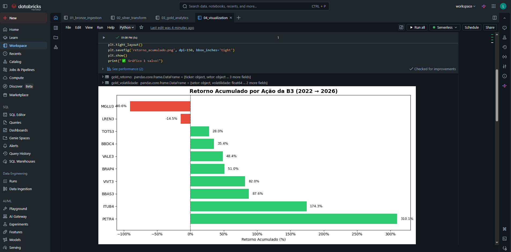
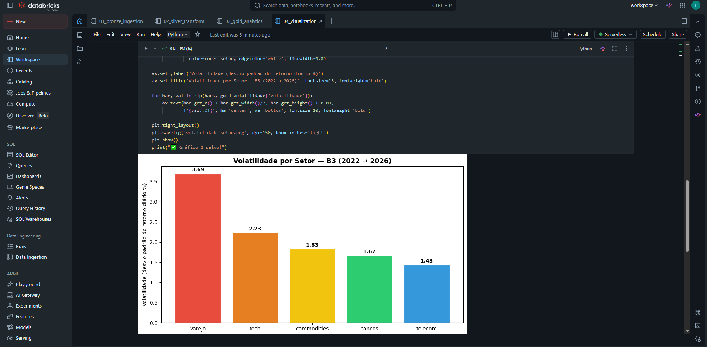

# Pipeline de ações da B3 em Databricks: retorno e volatilidade por setor

Mercado de ações é um assunto que eu acompanho, e quis usá-lo como base para um projeto prático de dados. Neste projeto eu coleto o histórico de dez ações brasileiras desde 2022, organizo os dados em camadas (Bronze, Silver e Gold) com PySpark e Delta Lake no Databricks, e analiso o retorno e a volatilidade por ação e por setor.

O objetivo não é criar uma estratégia de investimento. É mostrar o caminho de um dado, da ingestão até uma análise que responde uma pergunta.

## A pergunta que o projeto responde

Quais ações e quais setores da B3 tiveram o maior retorno e a maior volatilidade desde 2022?

## Resultados da análise

- A PETR4 teve o maior retorno acumulado do período, acima de 300%.
- A MGLU3 teve queda próxima de 90%.
- O varejo apareceu como o setor mais volátil entre os cinco analisados (varejo, tech, commodities, bancos e telecom).

Os gráficos de retorno acumulado e de volatilidade por setor estão na pasta `docs/results`.

## Arquitetura

```
yfinance
    ↓
Bronze: bronze_b3_stocks
    ↓
Silver: silver_b3_stocks
    ↓
Gold Analytics: ranking de retorno + volatilidade por setor
    ↓
Visualizações
```

- **Bronze:** guarda os dados brutos como chegaram da fonte.
- **Silver:** aplica tipagem e transformações. Window Functions separam cada ticker em ordem cronológica para calcular o retorno diário e o retorno acumulado.
- **Gold Analytics:** consolida o ranking de retorno e a volatilidade por setor, que alimentam os gráficos.

## Decisões que tomei

- **Window Functions por ticker:** o retorno de cada ação só faz sentido comparado ao pregão anterior da mesma ação, por isso os dados são particionados por ticker e ordenados por data.
- **Camadas Bronze, Silver e Gold:** para separar o dado bruto do dado tratado e do dado pronto para análise, sem perder a origem.
- **Delta Lake:** para gravar as tabelas em um formato pensado para o Spark.

## Notebooks

| Notebook | O que faz |
|---|---|
| `01_bronze_ingestion` | Coleta os dados com yfinance e grava a Bronze |
| `02_silver_transform` | Trata os dados e calcula os retornos |
| `03_gold_analytics` | Gera o ranking de retorno e a volatilidade por setor |
| `04_visualization` | Cria os gráficos |

## Tecnologias

Python, pandas e matplotlib | PySpark e Spark SQL | Delta Lake | Databricks Free Edition | yfinance

## Como executar

1. Crie um workspace no Databricks Free Edition.
2. Importe os notebooks da pasta `notebooks`.
3. Execute os notebooks de `01` a `04` em ordem.

As dependências são instaladas nos próprios notebooks com `%pip install`. As tabelas são sobrescritas a cada execução, então uma versão atualizada de um notebook deve rodar antes dos que dependem dela.

#### Resultados da análise descritiva





## Limitações e próximos passos

- A execução ainda é manual. Databricks Jobs ou Airflow poderiam organizar as dependências, as tentativas e o agendamento.
- Os dados vêm do yfinance, uma fonte gratuita e não oficial, adequada para estudo e não para decisão de investimento.


